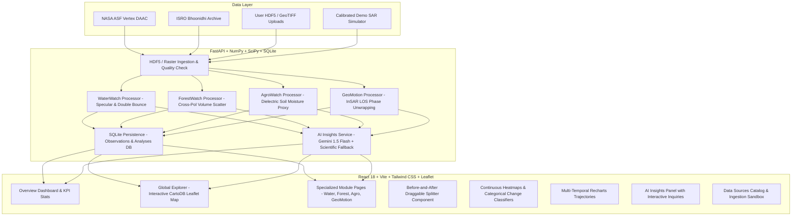

# TerraWatch – NISAR Earth Surface Change Intelligence Platform

> **Earth Surface Change Intelligence Platform** • *Powered by NASA-ISRO NISAR*  
> *"Turning NISAR radar observations into understandable insights about Earth's constantly changing surface."*

---

## 1. Executive Summary

**TerraWatch** is an integrated, scientific Earth observation and intelligence platform powered by the **NASA-ISRO Synthetic Aperture Radar (NISAR)** mission. Operating in both L-band ($23.84\text{ cm}$) and S-band ($9.37\text{ cm}$), NISAR delivers all-weather, day-and-night microwave imaging of Earth’s land and ice surfaces on a 12-day orbital repeat cadence.

Complex radar products—specifically **GCOV** (Geocoded Polarimetric Backscatter) and **GUNW** (Geocoded Unwrapped Interferograms)—are traditionally challenging for environmental scientists, agriculturalists, and disaster responders to interpret. TerraWatch bridges this divide by providing:
- **Interactive Multi-Temporal Swipe Comparisons** (Before vs After SAR observations).
- **Domain-Specific Geophysical Processors** (Water, Forest, Agriculture, and Crustal Deformation).
- **Physical Scatter & InSAR Area Calculations** ($km^2$ and displacement statistics).
- **AI-Assisted Interpretation Engine** powered by Google Gemini (with an internal scientific synthesis fallback engine).
- **Strict Separation Between Real & Demonstration Data** with live HDF5/GeoTIFF ingestion capabilities.

---

## 2. Platform Architecture



---

## 3. Four Core Monitoring Modules

### 1. WaterWatch – Hydrology, Wetlands & Flood Inundation
- **Sensor Input:** NISAR L-band GCOV (Co-polarized $HH$).
- **Scattering Physics:**
  - *Specular Reflection:* Smooth open water acts like a mirror, reflecting radar pulses away from the antenna, generating dark signatures ($\Delta \sigma^0 \le -3.0\text{ dB}$).
  - *Double-Bounce Scatter:* Standing water beneath vegetation trunks/stems creates a $90^\circ$ corner reflector, creating bright radar returns ($\Delta \sigma^0 \ge +2.5\text{ dB}$).
- **Calculations:** Newly inundated open water ($km^2$), flooded vegetation ($km^2$), receded floodwaters ($km^2$).

### 2. ForestWatch – Deforestation & Wildfire Burn Scars
- **Sensor Input:** NISAR L-band GCOV (Cross-polarized $HV$).
- **Scattering Physics:**
  - Cross-polarized backscatter is dominated by multiple volume scattering within the 3D crown structure of branches and foliage.
  - Canopy removal, clear-cutting, and wildfire foliage destruction remove volume scatterers, producing steep drops ($\Delta \sigma^0_{HV} \le -2.5\text{ dB}$).
- **Scientific Caveat:** Radar backscatter decreases reflect changes in scatterers and moisture. A drop alone does **not** definitively prove permanent deforestation without optical/thermal corroboration.

### 3. AgroWatch – Cropland Phenology & Soil Moisture
- **Sensor Input:** NISAR L-band GCOV (Dual-pol $HH+HV$).
- **Dielectric Physics:**
  - Microwave penetration into top 0–5 cm of soil makes $HH$ backscatter sensitive to dielectric constant ($\epsilon \approx 3.5$ dry soil to $\approx 35$ wet soil).
  - Semi-empirical inversion proxy: $\Delta \text{SM} \approx \Delta \sigma^0 \times 0.045\text{ m}^3/\text{m}^3\text{ per dB}$.
- **Distinction:** Explicitly separates direct backscatter measurements ($dB$) from derived volumetric soil moisture estimates ($m^3/m^3$).

### 4. GeoMotion – Earthquakes, Fault Ruptures & Subsidence
- **Sensor Input:** NISAR L-band GUNW (Geocoded UNWrapped Interferograms).
- **Interferometric Physics:**
  - **Does NOT subtract backscatter!** Converts interferometric unwrapped phase difference $\Delta \phi$ (radians) into Line-of-Sight (LOS) crustal displacement:
    $$d_{\text{LOS}} = -\frac{\lambda}{4\pi} \Delta \phi \quad (\lambda = 23.84\text{ cm})$$
    *One full interferometric fringe ($2\pi$) equals $11.92\text{ cm}$ of Line-of-Sight displacement.*
  - Low-coherence areas ($\gamma < 0.35$) caused by dense vegetation decorrelation are strictly masked out.

---

## 4. AI Insights Engine (Gemini API & Scientific Fallback)

TerraWatch adheres strictly to NASA scientific integrity guidelines:
1. **Zero Hallucination Guarantee:** The AI prompt receives *only* verified calculated numbers, spatial extents ($km^2$), decibel anomalies, and acquisition dates.
2. **Hypothesis Formulation:** All potential drivers (e.g. overbank flow, timber harvesting, irrigation pulses, fault slip) are explicitly framed as **unconfirmed hypotheses**.
3. **Multi-Sensor Verification:** Recommends concrete validation procedures (Sentinel-2 MNDWI/NDVI, Landsat-8/9 thermal, USGS ShakeMaps, continuous GNSS stations, NASA SMAP soil moisture, river gauge networks).
4. **Resilient Dual-Mode Operation:**
   - When `GEMINI_API_KEY` is provided: Calls Gemini 1.5 Flash via REST with structured JSON schemas.
   - When offline or without API key: Employs the built-in **TerraWatch Earth Observation Synthesis Engine**, providing publication-grade remote sensing explanations.

---

## 5. Technology Stack

- **Frontend:**
  - React 18 with Vite
  - Tailwind CSS with custom Earth Observation glassmorphic styling
  - React Router DOM v6
  - Leaflet & React-Leaflet with CartoDB Dark Matter basemaps
  - Recharts for multi-temporal trajectories
  - Lucide React icons
- **Backend:**
  - Python 3.12 with FastAPI
  - NumPy, SciPy & Pandas
  - h5py for reading NISAR HDF5 datasets
  - SQLite for persistence (`terrawatch.db`)
  - python-multipart for file upload ingestion
  - httpx for async AI orchestration
- **Data & Missions:**
  - NASA-ISRO NISAR (L-band & S-band)
  - NASA ASF Vertex DAAC
  - ISRO Bhoonidhi Portal
  - CSA RADARSAT & CONAE SAOCOM references

---

## 6. Getting Started & Installation

### Prerequisites
- Node.js (v18+ or v20+)
- Python (v3.10, v3.11, or v3.12)

### Step 1: Clone the Repository
```bash
git clone https://github.com/terrawatch/terrawatch.git
cd terrawatch
```

### Step 2: Configure Environment Variables
Create a `.env` file in the project root (or inside `backend` and `frontend`):
```bash
cp .env.example .env
```
Inside `.env`:
```env
# Optional: Set Gemini API key for live AI insights (scientific fallback used if omitted)
GEMINI_API_KEY=your_gemini_api_key_here

# Frontend Vite API Proxy Target
VITE_API_URL=http://localhost:8000
```

### Step 3: Run the Backend (FastAPI)
```bash
# Navigate to backend directory
cd backend

# Install dependencies
pip install -r requirements.txt

# Start FastAPI development server
python -m uvicorn app.main:app --host 0.0.0.0 --port 8000 --reload
```
*The backend API documentation is immediately available at `http://localhost:8000/docs`.*

### Step 4: Run the Frontend (React + Vite)
In a separate terminal:
```bash
# Navigate to frontend directory
cd frontend

# Install npm packages
npm install

# Start Vite development server
npm run dev
```
*Open your browser and navigate to `http://localhost:5173`.*

---

## 7. Backend API Specification

| Method | Endpoint | Description |
|---|---|---|
| `GET` | `/api/health` | Service health, version, and Gemini API readiness check. |
| `GET` | `/api/stats` | High-level platform KPIs (regions, observations, total area). |
| `GET` | `/api/regions` | Cataloged study areas filtered by monitoring module. |
| `GET` | `/api/observations` | Processed satellite observation passes with orbit directions. |
| `GET` | `/api/analyses` | Historical analysis runs stored in SQLite. |
| `GET` | `/api/analysis/{id}` | Full raster grids, statistics, and metadata for a specific run. |
| `POST` | `/api/analyze/water` | Run WaterWatch backscatter change & flood extent processor. |
| `POST` | `/api/analyze/forest` | Run ForestWatch cross-pol crown volume scattering processor. |
| `POST` | `/api/analyze/agriculture` | Run AgroWatch dielectric soil moisture & phenology processor. |
| `POST` | `/api/analyze/deformation` | Run GeoMotion InSAR line-of-sight displacement processor. |
| `POST` | `/api/insights` | Generate AI-assisted scientific interpretation for an analysis. |
| `POST` | `/api/upload` | Ingest real NISAR HDF5 (`.h5`) or GeoTIFF (`.tif`) products. |

---

## 8. Authoritative Data Sources

- **NASA ASF Vertex:** [https://search.asf.alaska.edu/](https://search.asf.alaska.edu/)
- **NASA Earthdata Search:** [https://search.earthdata.nasa.gov/](https://search.earthdata.nasa.gov/)
- **ISRO Bhoonidhi Portal:** [https://bhoonidhi.nrsc.gov.in/](https://bhoonidhi.nrsc.gov.in/)
- **NISAR Science Documentation:** [https://nisar-docs.asf.alaska.edu/](https://nisar-docs.asf.alaska.edu/)
- **NASA ARSET Remote Sensing Trainings:** [https://appliedsciences.nasa.gov/get-involved/training](https://appliedsciences.nasa.gov/get-involved/training)
- **CSA RADARSAT Constellation:** [https://donnees-data.asc-csa.gc.ca/en/dataset/rcm](https://donnees-data.asc-csa.gc.ca/en/dataset/rcm)
- **CONAE SAOCOM Catalog:** [https://catalogos.conae.gov.ar/catalogo/catalogoSatSaocomInfo.html](https://catalogos.conae.gov.ar/catalogo/catalogoSatSaocomInfo.html)

---

## 9. License & Open Source Attribution

Developed for **Global Earth Observation & NISAR Radar Surface Intelligence**.  
Distributed under the **Apache 2.0 Open Source License**.  
*Satellite imagery and synthetic aperture radar algorithms inspired by NASA JPL, ISRO SAC, and Alaska Satellite Facility DAAC standards.*
